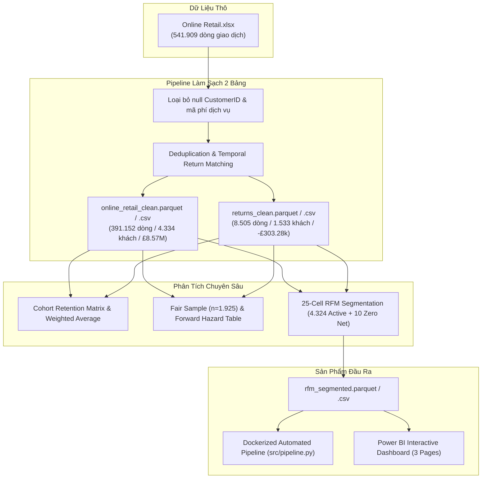

# B2B Customer Retention & RFM Segmentation Pipeline
> **End-to-End Analytics & Data Engineering Portfolio Project**  
> Analyzing longitudinal transactional behavior, mitigating right-censoring, establishing a mathematically validated 25-cell RFM grid, and modeling incremental retention revenue for a B2B wholesale giftware business.

---

## 📑 Mục Lục (Table of Contents)
1. [Tổng Quan Dự Án & Vấn Đề Kinh Doanh](#1-tổng-quan-dự-án--vấn-đề-kinh-doanh)
2. [Điểm Sáng Kỹ Thuật (Key Technical Innovations)](#2-điểm-sáng-kỹ-thuật-key-technical-innovations)
3. [Kiến Trúc Luồng Dữ Liệu (Pipeline Architecture)](#3-kiến-trúc-luồng-dữ-liệu-pipeline-architecture)
4. [Tóm Tắt Phát Hiện Cốt Lõi (Key Findings)](#4-tóm-tắt-phát-hiện-cốt-lõi-key-findings)
5. [Cấu Trúc Thư Mục Dự Án (Repository Structure)](#5-cấu-trúc-thư-mục-dự-án-repository-structure)
6. [Hướng Dẫn Tái Lập Môi Trường 1-Click (Quickstart)](#6-hướng-dẫn-tái-lập-môi-trường-1-click-quickstart)
7. [Tích Hợp Dashboard Power BI](#7-tích-hợp-dashboard-power-bi)
8. [Mẫu Trình Bày Trên CV (CV Bullet Points)](#8-mẫu-trình-bày-trên-cv-cv-bullet-points)

---

## 1. Tổng Quan Dự Án & Vấn Đề Kinh Doanh

Trong mô hình kinh doanh bán buôn/bán sỉ quà tặng (B2B Wholesale), việc giữ chân khách hàng cũ mang lại hiệu quả chi phí vượt trội so với tìm kiếm khách hàng mới. Tuy nhiên, doanh nghiệp thường gặp 3 thách thức lớn:
* **Không phân biệt được khách hàng lớn (Whales):** Thiếu mô hình phân khúc khoa học dẫn đến việc đối xử cào bằng giữa khách hàng mua sỉ lớn và người mua nhỏ lẻ.
* **Đo lường giữ chân bị méo:** Đánh giá tỷ lệ mua lặp lại bị méo mó do ảnh hưởng của khách hàng cũ (Cohort 12/2010) và hiện tượng cắt cụt dữ liệu bên phải (**Right-Censoring**).
* **Khuyến mãi làm xói mòn lợi nhuận:** Tung voucher giảm giá đại trà gây tự ăn vào doanh thu tự nhiên (**Cannibalization**).

**Giải pháp của dự án:**  
Xây dựng một Data Pipeline hoàn chỉnh từ dữ liệu thô (541.909 dòng), thực hiện đối soát hoàn trả chặt chẽ, đo lường xác suất có điều kiện mua lại (Forward Hazard Analysis), xây dựng lưới phân khúc RFM 5×5 (25 ô tổ hợp) với 100% kiểm định bất biến tự động, và thiết kế khung thử nghiệm A/B Testing có nhóm đối chứng (Holdout Group).

---

## 2. Điểm Sáng Kỹ Thuật (Key Technical Innovations)

Khác với các đồ án RFM đại trà, dự án này giải quyết triệt để các bài toán khó về dữ liệu và thống kê:

1. **Kiểm soát triệt để Right-Censoring (Mẫu công bằng - Fair Sample $n = 1.925$):**
   * Bác bỏ nhận định sai lầm "36,1% khách bỏ đi ngay sau đơn đầu" do bị cắt cụt thời gian ở các cohort cuối năm.
   * Thiết lập cửa sổ cố định 180 ngày trên nhóm khách mới thuần túy (đơn đầu $\le$ 12/06/2011) $\rightarrow$ Đo lường chính xác **63,4% khách hàng quay lại mua** trong vòng 6 tháng với **trung vị chu kỳ lặp lại là 59,8 ngày (~60 ngày)**.
   * Đối chiếu toàn kỳ theo dõi (180–339 ngày): tỷ lệ chưa từng mua lại giảm xuống **26,6%** (512 khách) với Median đạt **71,0 ngày** (Q1 = 32,8 ngày, Mean = 90,0 ngày, Q3 = 133,0 ngày, P90 = 200,0 ngày).
2. **Khảo sát tỷ lệ rủi ro tiến (Forward 30-Day Hazard Rate):**
   * Khắc phục lỗi cửa sổ co hẹp bằng cách đo xác suất mua lại trong 30 ngày kế tiếp $[X, X+30]$ cho khách chưa mua tại ngày $X$.
   * Chứng minh Hazard Rate nền phẳng ở mức **14,6% – 18,0%**, không có điểm gãy đột ngột quanh ngày 70.
   * Khẳng định rủi ro tự ăn doanh thu (Cannibalization) từ voucher ngắn hạn là thấp vì **82% – 85% khách chưa mua sẽ không tự phát sinh giao dịch**.
3. **Khắc phục lỗi phân vị `pd.qcut` trên Frequency:**
   * Vì 34,6% khách hàng hoạt động chỉ có đúng 1 đơn hàng ($F=1$), việc ép chia phân vị bằng `pd.qcut` sẽ gây lỗi `Bin edges must be unique` hoặc tạo ra sai lệch ngẫu nhiên do thứ tự dòng khi dùng `rank(method='first')`.
   * Dự án áp dụng phân vị rời rạc theo nghiệp vụ (Domain Cut: 1, 2, 3, 4–5, $\ge 6$ đơn).
4. **Bản đồ 25 ô tổ hợp (5×5 Grid) với Assertions 100%:**
   * Bao phủ trọn vẹn 4.324 khách hàng hoạt động (Active Customers) không trùng lặp và không bỏ sót. Ô $(3,1)$ (296 khách) và $(3,2)$ (179 khách) được chuẩn hóa vào nhóm **Promising** (475 khách hàng).
   * Tách riêng 10 khách hàng **Zero Net Spend** (mua rồi hủy sạch 100% đơn gốc, kiểm soát sai số float $|net| < £0,005$) bảo tồn giá trị Recency/Frequency thật và gắn cờ kỹ thuật `IsZeroNet = True`.
5. **Đóng gói công nghiệp (Production Containerization):**
   * Tách rời tầng xử lý lõi thành module Python (`src/pipeline.py`) và đóng gói qua **Docker** / **docker-compose**, sẵn sàng chạy định kỳ (Scheduled Batch Job).

---

## 3. Kiến Trúc Luồng Dữ Liệu (Pipeline Architecture)



---

## 4. Tóm Tắt Phát Hiện Cốt Lõi (Key Findings)

### 4.1. Độ Lệch Pareto Cực Lớn Trong B2B Wholesale
| Phân vị khách hàng | Số lượng khách hàng | Tỷ trọng đóng góp doanh thu (%) |
| :--- | :---: | :---: |
| **Top 1% Khách Hàng Lớn Nhất** | 43 khách | **30,2%** |
| **Top 10% Khách Hàng** | 432 khách | **60,1%** |
| **Top 20% Khách Hàng** | 865 khách | **73,8%** |
| **Phân khúc Champions** | **1.023 khách (23,7%)** | **66,9%** (£5,55 triệu bảng) |

### 4.2. Bác Bỏ Giả Thuyết Mở Rộng Doanh Thu (Revenue Expansion) Ở Khách Mới
* Doanh thu trên mỗi khách hoạt động (RPA) của khách mới các cohort 2011 duy trì **phẳng quanh ~100% so với Tháng 0**.
* Hiện tượng tăng vọt chi tiêu theo thời gian chỉ xuất hiện ở Cohort cũ 12/2010 (nhóm khách sỉ trung thành lâu năm cộng hưởng mùa cao điểm Q4).
* Chiến lược cho khách mới là **bảo vệ tần suất mua hàng**, không phải cố gắng ép AOV tăng đột ngột.

### 4.3. Mô Hình Tác Động Tài Chính
* Cải thiện **+2.0 điểm % tỷ lệ giữ chân Tháng 1** giúp giữ lại thêm **~74,4 khách hàng/năm**.
* Tạo ra **~£32.764 doanh thu gộp tăng thêm ngay trong Tháng 1** (tương đương **£9.174 lợi nhuận gộp** với biên lợi nhuận 28%).
* Giá trị vòng đời khách hàng tích lũy ước tính tăng thêm **> £81.900/năm**.

---

## 5. Cấu Trúc Thư Mục Dự Án (Repository Structure)

```
customer-retention-analysis/
│
├── data/
│   ├── raw/
│   │   └── Online Retail.xlsx               # Dữ liệu giao dịch gốc
│   └── processed/
│       ├── online_retail_clean.parquet / .csv # Bảng đơn mua hàng sạch (Gross Purchases)
│       ├── returns_clean.parquet / .csv       # Bảng hoàn trả có cờ IsMatched
│       └── rfm_segmented.parquet / .csv       # Bảng phân khúc 4.334 khách hàng (kèm cờ IsZeroNet)
│
├── notebooks/
│   ├── 01_data_cleaning.ipynb               # Làm sạch 2 bảng độc lập & đối soát
│   ├── 02_cohort_analysis.ipynb             # Ma trận Cohort, Mẫu công bằng, Hazard Rate
│   ├── 03_rfm_segmentation.ipynb            # Chấm điểm RFM, Lưới 25 ô, Assertions
│   └── 04_insights.ipynb                    # CRM Playbook, A/B Testing, Mô hình doanh thu
│
├── src/
│   └── pipeline.py                          # Script Python tự động hóa End-to-End
│
├── docs/
│   └── powerbi_dashboard_guide.md           # Hướng dẫn Star Schema & DAX cho Power BI
│
├── Dockerfile                               # Đóng gói container môi trường Python 3.11
├── docker-compose.yml                       # Chạy pipeline 1 lệnh duy nhất
├── requirements.txt                         # Danh sách thư viện đầy đủ (Notebooks)
├── requirements-prod.txt                    # Thư viện tối giản cho Production Engine
└── README.md                                # Tài liệu kỹ thuật dự án
```

---

## 6. Hướng Dẫn Tái Lập Môi Trường 1-Click (Quickstart)

### Cách 1: Chạy Bằng Docker (Khuyến nghị - Không cần cài Python)
```bash
# Clone repository
git clone https://github.com/your-username/customer-retention-analysis.git
cd customer-retention-analysis

# Chạy tự động toàn bộ pipeline qua Docker Compose
docker compose up --build
```
*Toàn bộ quá trình làm sạch, tính toán Cohort và phân khúc RFM sẽ tự động thực thi và xuất tệp vào thư mục `data/processed/` trong ~30 giây.*

### Cách 2: Chạy Trên Môi Trường Python Cục Bộ
```bash
# Tạo môi trường ảo Python 3.11
python3 -m venv .venv
source .venv/bin/activate

# Cài đặt thư viện
pip install -r requirements.txt

# Chạy pipeline tự động
python src/pipeline.py
```

---

## 7. Tích Hợp Dashboard Power BI

Dự án cung cấp tài liệu chi tiết tại [`docs/powerbi_dashboard_guide.md`](file:///home/lmh/customer-retention-analysis/docs/powerbi_dashboard_guide.md) để xây dựng Dashboard 3 trang:
* **Page 1:** Executive KPI Overview & Pareto Lorenz Analysis.
* **Page 2:** Cohort Retention Heatmap (Conditional Formatting Color Scale).
* **Page 3:** RFM 5×5 Matrix & Customer 360 Lookup (Tra cứu khách hàng theo `CustomerID`).

---

## 8. Mẫu Trình Bày Trên CV (CV Bullet Points)

Bạn có thể sao chép trực tiếp các gạch đầu dòng sau vào mục **Projects** trong CV của mình:

### Vị trí: Data Analyst / BI Developer
* **End-to-End B2B Customer Retention & RFM Analysis (Python, Power BI, Docker):**
  * Xây dựng pipeline dữ liệu sạch 2 bảng từ 541k+ dòng giao dịch bán sỉ, thiết kế thuật toán Temporal Matching xử lý 8.5k đơn hủy và kiểm soát sai số float phân lập chính xác 10 tài khoản Zero Net Spend.
  * Phân tích Cohort kiểm soát triệt để Right-Censoring trên Mẫu công bằng ($n = 1.925$), xác định trung vị chu kỳ mua lại là 59,8 ngày trong 180 ngày và tỷ lệ mua lại nền trong 30 ngày đạt 15%–18%.
  * Xây dựng mô hình phân khúc RFM lưới 5×5 (25 ô tổ hợp hoàn chỉnh) được kiểm định tự động bằng assertions, chỉ ra nhóm Champions chiếm 23,7% khách hàng nhưng đóng góp 66,9% doanh thu.
  * Thiết kế khung thử nghiệm A/B Testing Ngày 45 vs Ngày 75 có nhóm đối chứng Holdout, lượng hóa mức tăng trưởng +£32.8k doanh thu Tháng 1 từ việc nâng +2.0 điểm % retention.
  * Xây dựng Dashboard Power BI tương tác 3 trang (Star Schema, DAX) và đóng gói pipeline chạy tự động 1-click qua Docker.

### Vị trí: Data Engineer / Backend Developer
* **B2B Retention & RFM Data Pipeline (Python, Pandas, Docker, Parquet):**
  * Thiết kế kiến trúc xử lý dữ liệu chuẩn hóa, tối ưu hóa lưu trữ với định dạng Apache Parquet, rút ngắn thời gian tính toán toàn bộ pipeline xuống 1,1 giây.
  * Triệt tiêu lỗi phân vị trùng giá trị của `pd.qcut` bằng thuật toán phân đoạn rời rạc theo miền nghiệp vụ (Custom Domain Cut), bảo đảm tính toàn vẹn 100% cho 4.324 khách hàng hoạt động.
  * Đóng gói toàn bộ pipeline xử lý dữ liệu thành Docker container đa tầng (Multi-stage Dockerfile), hỗ trợ chạy batch job 1-click không phụ thuộc môi trường.
